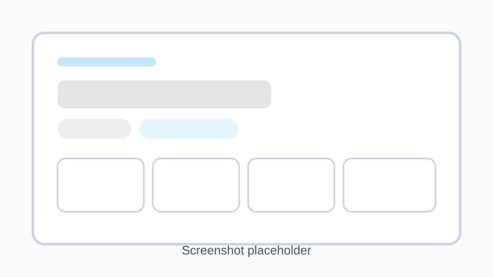

# What Is My IP

`What Is My IP` is a responsive Next.js web tool that detects a visitor's public IP address and shows geolocation, network, timezone, currency, and map details using the ipgeolocation.io API.



## Features

- Automatic IP detection on page load
- Server-side API requests only
- Session-scoped in-memory caching to avoid repeat lookups on refresh
- Country flag, location, ISP, organization, timezone, currency, and calling code display
- Embedded OpenStreetMap map with Leaflet
- Copy IP action and placeholder link for `/ip-lookup`
- SEO metadata, Open Graph image, `robots.txt`, `sitemap.xml`, and favicon

## Setup

1. Install dependencies:

   ```bash
   npm install
   ```

2. Create a `.env` file in the project root:

   ```env
   IPGEOLOCATION_API_KEY=your_api_key_here
   ```

3. Start the development server:

   ```bash
   npm run dev
   ```

4. Open `http://localhost:3000`.

## Environment Variables

Required:

- `IPGEOLOCATION_API_KEY`: your ipgeolocation.io API key

Optional:

- `NEXT_PUBLIC_SITE_URL`: absolute production URL used for sitemap and metadata output

## Deployment

Deploy on Vercel:

1. Push the repo to GitHub.
2. Import the project in Vercel.
3. Add `IPGEOLOCATION_API_KEY` in the Vercel project environment variables.
4. Set `NEXT_PUBLIC_SITE_URL` to the deployed URL.
5. Deploy.

## Notes

- The app uses a session cookie plus an in-memory cache to avoid repeating the lookup during the same browser session.
- For production accuracy, the server attempts to use the visitor IP from proxy headers. If only a local or private IP is available, it falls back to the caller-IP API behavior.
- Powered by ipgeolocation.io.

